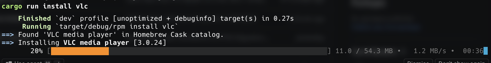

# Rory's Package Manager (`rpm`) for macOS


> [!WARNING]
> **Beta Software Disclaimer**: `rpm` is currently in active **beta** (current version tracked in [`Cargo.toml`](Cargo.toml)). While core safety guards such as atomic bundle swaps, automatic rollback, and unmanaged app protection—are in place, features and CLI behavior may still evolve before `v1.0.0`.

NOT TO BE CONFUSED WITH "red hat package manager (rpm) for linux", it is annoying and unfortunate that they have the same name as me, but I don't use Fedora (Arch obviously) and this package manager is for macOS. I will consider changing the name... never.

A fast, lightweight, and safe macOS CLI package manager written in Rust, designed for managing, updating, and installing unsigned and custom macOS software. In addition, it strips Apple's "quarantine" attribute and automatically registers applications with Spotlight and Launchpad.

This package manager utlises custom recipes for apps that are not maintained by homebrew as well as hooking into the existing api from homebrew to allow the install of any casks from their repo. To do this the .json files are converted to .toml on the fly and stored locally on your device.

Currently, only casks are supported from homebrew. Non GUI apps will be supported at a later date.



---

## Compatibility

Tested and verified on:
- Apple Silicon (MacBook M3 Pro): macOS 15+ / 26.x
- Supported architectures: `arm64` (Apple Silicon) & `x86_64` (Intel)

---

## Key Features

- **Index-Free On-Demand Resolution**: No multi-gigabyte local catalogs or slow bulk clones. `rpm install <app>` resolves on demand: local recipes $\to$ GitHub raw manifests $\to$ Homebrew Cask API.
- **Dual-Track Homebrew Cask Importer**: Install any Homebrew cask via either:
  - **Verified Track** (`--verified`): Tested download URL and Homebrew-verified SHA-256 digest.
  - **Upstream Track** (`--upstream`): Direct developer upstream release with dynamic single-pass checksumming for zero-day updates.
- **Declarative TOML Recipes (`recipes/rpm/*.toml`)**: Native packages are defined in simple TOML manifests with zero Rust recompilation required to add or modify apps.
- **Smart Alias Resolution**: Install and manage apps using intuitive shortcuts (e.g. `qbt` $\to$ `qBittorrent`, `chrome` $\to$ `Chromium`, `vlc` $\to$ `VLC media player`).
- **Cryptographic Single-Pass Verification**: Streams incoming payloads directly through a SHA-256 hasher during download with atomic `.part` promotion.
- **Running App Protection & Atomic Swaps**: Detects running applications before upgrading, requests graceful quit, and uses an atomic directory swap with automatic rollback to protect active apps from crashes or partial overwrite corruption.
- **Instant System Registration**: Force-registers newly installed apps with Launch Services (`lsregister -f`), Spotlight (`mdimport`), and refreshes directory timestamps (`touch`) so apps appear immediately in Spotlight and Launchpad without opening Finder.
- **Gatekeeper Quarantine Stripping**: Automatically strips Apple's `com.apple.quarantine` extended attribute on unsigned apps, with a per-package `quarantine_strip` toggle.
- **Package Conflict & Compatibility Protection**: Prevents installing incompatible or mutually exclusive applications (e.g. stable `Chromium` vs bleeding-edge `Chromium Snapshot`) via bidirectional `conflicting_applications` recipe rules.
- **Unmanaged Application Protection (Homebrew-Inspired)**: Refuses to overwrite or automatically update existing applications in `/Applications` that were not installed through `rpm`.
- **Pip-Style Dynamic Progress Bar**: Real-time terminal progress bar featuring download speed (EMA smoothed), downloaded/total MB counter, and remaining ETA that dynamically scales with terminal width.
- **Dual-Mode Engine**: Operates seamlessly as an installed system binary (`/opt/rpm/bin/rpm`) or in local repository development mode (`cargo run --`).

---

## Installation & Setup

### System Installation
Build and install `rpm` directly onto your machine:
```sh
./scripts/install-local.sh
```
This script:
1. Compiles the optimized release binary (`cargo build --release`).
2. Installs the executable to `/opt/rpm/bin/rpm`.
3. Adds `/opt/rpm/bin` to your system `$PATH` via `/etc/paths.d/rpm`.
4. Seeds persistent recipes to `~/.rpm/recipes/rpm/`.

Once installed, restart your terminal and run `rpm` directly:
```sh
rpm update
rpm install vlc
```

### Uninstallation
To cleanly remove `rpm` from your system:
```sh
./scripts/uninstall-local.sh
```

### Local Development Mode
You can also run commands directly from source inside this repository:
```sh
cargo run -- <command>
```

---

## CLI Usage Guide

### 1. Check for Updates (`update`)
Scan currently installed applications, check upstreams for new releases, compare versions, and refresh cache:
```sh
rpm update
```
Pass `-v` (or `--verbose`) for detailed diagnostic output including system architecture, payload URLs, and expected SHA-256 hashes:
```sh
rpm update -v
```
*(Only checks packages currently installed on your machine. Unmanaged applications installed outside `rpm` are skipped from update queues).*

### 2. Upgrade Applications (`upgrade`)
Download, verify SHA-256, and install pending updates for managed applications:
```sh
rpm upgrade
```
Pass `-c` (or `--clean`) to bypass cached payloads in staging and force fresh downloads:
```sh
rpm upgrade -c
```

### 3. Install Applications (`install`)
Install an application by its canonical name, alias, or Homebrew cask token:
```sh
rpm install qbt
rpm install chromium
rpm install librewolf
rpm install vlc
```

#### Track Selection for Homebrew Casks:
- **Verified Track** (tested Homebrew release with verified checksum):
  ```sh
  rpm install vlc --verified
  ```
- **Upstream Track** (direct developer release from GitHub/upstream):
  ```sh
  rpm install vlc --upstream
  ```
- **Clean Install** (bypass/purge cached staging payload):
  ```sh
  rpm install -c vlc
  ```

> **Security Guard:** If an application is already installed in `/Applications` but was **not installed by `rpm`** (unmanaged), `rpm` refuses to overwrite it to preserve user data and system integrity. To manage it with `rpm`, remove the existing `.app` bundle first, then run `rpm install <app>`.

### 4. List Installed Packages (`list`)
View locally installed packages and their versions:
```sh
rpm list
```
Pass `-v` or `--verbose` for detailed inspection, including bundle paths, descriptions, and origin badges (`[recipe: rpm]`, `[recipe: homebrew (verified)]`, `[recipe: homebrew (upstream)]`):
```sh
rpm list -v
```

### 5. Configure Homebrew Track Preferences (`homebrew`)
View the current default track preference for Homebrew casks:
```sh
rpm homebrew
```
Set the global track preference:
```sh
rpm homebrew -default     # Always use Homebrew verified track
rpm homebrew -upstream    # Always use developer upstream track
rpm homebrew -request     # Prompt interactively on each new cask install
```

### 6. Uninstall Applications (`uninstall`)
Safely remove a managed application from `/Applications`, unregister it from Launch Services, clean up auto-generated Homebrew recipe manifests, and update cache:
```sh
rpm uninstall vlc
```

### 7. Clean Cached Downloads (`cleanup`)
Remove cached download archives from staging to free disk space (alias: `rpm clean`):
```sh
rpm cleanup            # Clean all cached payloads
rpm cleanup librewolf  # Clean cached payloads for a specific package
```

---

## Adding Native Packages (TOML Recipes)

To add a new curated application, add a TOML file under `recipes/rpm/<app_name>.toml`. Adding a package requires **zero Rust recompilation**.

### Example: GitHub Release App (`recipes/rpm/qbittorrent.toml`)
```toml
name = "qBittorrent"
aliases = ["qbittorrent", "qbt"]
bundle_name = "qBittorrent.app"
homepage = "https://www.qbittorrent.org"
description = "BitTorrent client with a Qt user interface"
quarantine_strip = true

[source]
type = "github_release"
locator = "qbittorrent/qBittorrent"

[livecheck]
strategy = "github_latest_release"
```

### Example: Conflicting Packages (`recipes/rpm/chromium.toml` & `recipes/rpm/chromium-snapshot.toml`)
```toml
name = "Chromium"
aliases = ["chromium", "chrome"]
bundle_name = "Chromium.app"
homepage = "https://github.com/ungoogled-software/ungoogled-chromium-macos"
description = "Privacy-focused stable open-source Chromium browser"
quarantine_strip = true
conflicting_applications = ["Chromium Snapshot"]

[source]
type = "github_release"
locator = "ungoogled-software/ungoogled-chromium-macos"

[livecheck]
strategy = "github_latest_release"
```

For the complete recipe schema and livecheck options, see [GEMINI.md](GEMINI.md).

---

## Roadmap & Releases

- **Feature Backlog & Roadmap**: See [TO_DO.md](TO_DO.md) for prioritized upcoming features.
- **Release History**: See [CHANGELOG.md](CHANGELOG.md) for detailed notes on all versions.

---

## Credits & Inspirations

- **[Homebrew](https://brew.sh)**: For inspiring the unmanaged application protection pattern, recipe decoupling, and providing the public Homebrew Cask API.
- **[pip](https://pypa.github.io/pip/)**: For inspiring the clean, user-friendly CLI design and dynamic download progress bar UI.

---

## Homebrew Attribution & Third-Party Disclaimers

`rpm` integrates with the public **[Homebrew Formulae & Cask API](https://formulae.brew.sh/)** (`formulae.brew.sh/api/cask/<token>.json`) on demand to resolve package metadata, download URLs, and checksums for macOS casks.

- **Homebrew Cask & API Attribution**: Package metadata retrieved via the Homebrew API originates from **[Homebrew/homebrew-cask](https://github.com/Homebrew/homebrew-cask)** and **[Homebrew/formulae.brew.sh](https://github.com/Homebrew/formulae.brew.sh)**, both of which are licensed under the **[BSD 2-Clause "Simplified" License](https://github.com/Homebrew/homebrew-cask/blob/HEAD/LICENSE.txt)**. Full credit goes to the Homebrew maintainers and contributors for curating and maintaining the Cask ecosystem.
- **No Affiliation**: `rpm` (Rory's Package Manager) is an independent project and is not affiliated with, endorsed by, or maintained by the Homebrew project.
- **Third-Party Software Licenses**: `rpm` is strictly a package manager utility and recipe resolver. Installing an application via `rpm` (whether through a native `rpm` recipe or a Homebrew cask) downloads software directly from the original vendor's upstream servers. Neither `rpm` nor Homebrew grants any license rights to those third-party binaries—your use of any installed application is governed entirely by that software vendor's respective license or End-User License Agreement (EULA).

---

## License

Licensed under the **[BSD 2-Clause "Simplified" License](LICENSE)** — Copyright (c) 2026, Rory Miley.


