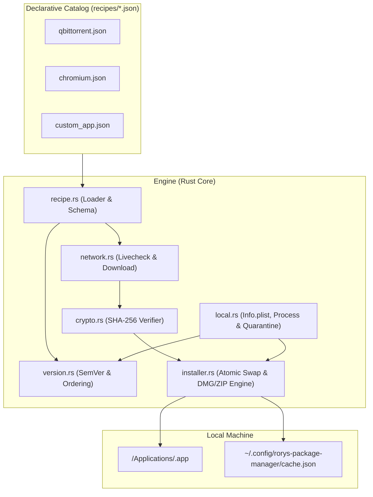
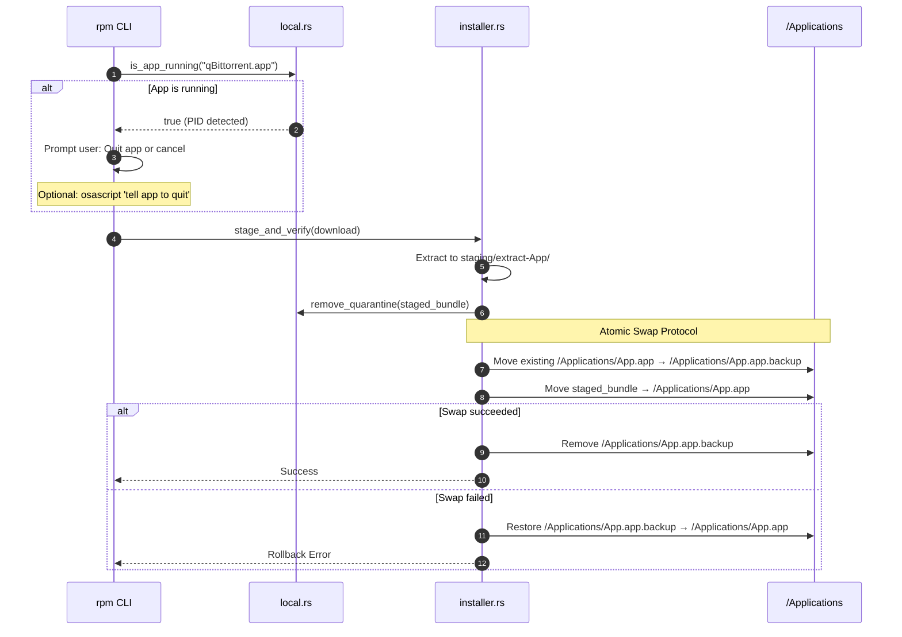

# Version 2 Roadmap: Architecture & Package Handler Modernization

This roadmap outlines the evolution of **`rorys-package-manager`** (`rpm`), incorporating proven architectural patterns from **Homebrew** (`homebrew-core` and `homebrew-cask`) while preserving the project's core identity: a lightweight, fast, and functional Rust-based manager for unsigned and custom macOS software.

---

## Table of Contents
1. [Core Architectural Principles](#1-core-architectural-principles)
2. [Module Architecture & Separation of Concerns](#2-module-architecture--separation-of-concerns)
3. [Deep Dive: Roadmap Initiatives (Points 1–7)](#3-deep-dive-roadmap-initiatives-points-17)
   - [Item 1 & 7: JSON Recipes & Decoupled Manifests](#item-1--7-json-recipes--decoupled-manifests)
   - [Item 2: Cryptographic Verification (SHA-256)](#item-2-cryptographic-verification-sha-256)
   - [Item 3: Pluggable Version Detection (Livecheck System)](#item-3-pluggable-version-detection-livecheck-system)
   - [Item 4: Semantic Version Comparison (`>` vs `!=`) & Ahead-of-Upstream Display](#item-4-semantic-version-comparison--vs--ahead-of-upstream-display)
   - [Item 5: Robust Archive Extraction & Bundle Inspection](#item-5-robust-archive-extraction--bundle-inspection)
   - [Item 6: Handling Currently Running Applications & Atomic Installs](#item-6-handling-currently-running-applications--atomic-installs)
   - [Chromium Handler Integration](#chromium-handler-integration)
4. [Step-by-Step Implementation Phases](#4-step-by-step-implementation-phases)
5. [Risk Analysis & Non-Breaking Safeguards](#5-risk-analysis--non-breaking-safeguards)

---

## 1. Core Architectural Principles

Homebrew separates **what** software is (a declarative manifest) from **how** it is fetched, unpacked, verified, and linked (the engine). Version 2 transitions `rorys-package-manager` from imperative, hardcoded endpoints to this decoupled model.



---

## 2. Module Architecture & Separation of Concerns

To keep the Rust code functional, idiomatic, and easily testable, responsibilities will be strictly partitioned across dedicated modules:

| Module File | Responsibility | Key Structs / Functions |
| :--- | :--- | :--- |
| `src/recipe.rs` *(New)* | Parsing and validating JSON recipe definitions, alias resolution. | `struct Recipe`, `load_recipe()`, `resolve_alias()` |
| `src/version.rs` *(New)* | Parsing version strings, semantic ordering (`>`, `<`, `==`), pre-release comparison. | `struct Version`, `enum VersionStatus`, `impl Ord for Version` |
| `src/network.rs` | HTTP client, pluggable Livecheck strategies, streaming download with SHA-256 calculation. | `fetch_upstream_version()`, `download_and_verify()`, `LivecheckStrategy` |
| `src/installer.rs` | DMG mounting (with license agreement bypass), ZIP extraction, bundle validation, atomic replacement. | `extract_container()`, `atomic_install_bundle()`, `rollback()` |
| `src/local.rs` | `Info.plist` reading, Gatekeeper quarantine stripping (`xattr`), active process detection (`pgrep`). | `get_local_version()`, `is_app_running()`, `remove_quarantine()` |
| `src/cache.rs` | Managing `cache.json`, tracking managed state, last check timestamps. | `UpdateCache`, `CachedApp`, `save_cache()`, `load_cache()` |
| `src/cli.rs` | Command routing, terminal UI output (Pip/Homebrew-styled colored badges). | `cmd_update()`, `cmd_upgrade()`, `cmd_install()` |

---

## 3. Deep Dive: Roadmap Initiatives (Points 1–7)

### Item 1 & 7: JSON Recipes & Decoupled Manifests

#### The Problem in V1:
The app catalog is hardcoded as `("qBittorrent", "github", "qbittorrent/qBittorrent")` in `cli.rs`. Adding an app or modifying an asset filter requires modifying Rust source code and recompiling.

#### The V2 Solution:
Move all package metadata into a dedicated `recipes/` directory. Each package gets its own JSON file defining identification, aliases, source/livecheck rules, and install options.

#### Recipe Schema (`recipes/qbittorrent.json`):
```json
{
  "name": "qBittorrent",
  "aliases": ["qbittorrent", "qbt"],
  "bundle_name": "qBittorrent.app",
  "homepage": "https://www.qbittorrent.org",
  "description": "BitTorrent client with a Qt user interface",
  "quarantine_strip": true,
  "source": {
    "type": "github_release",
    "locator": "qbittorrent/qBittorrent",
    "asset_filter": {
      "arm64": ".*_arm64\\.dmg$",
      "x86_64": ".*_x86_64\\.dmg$",
      "fallback": ".*\\.dmg$"
    }
  },
  "livecheck": {
    "strategy": "github_latest_release"
  }
}
```

#### Rust Schema Implementation (`src/recipe.rs`):
```rust
use serde::{Deserialize, Serialize};
use std::collections::HashMap;
use std::path::PathBuf;

#[derive(Debug, Clone, Serialize, Deserialize)]
pub struct Recipe {
    pub name: String,
    #[serde(default)]
    pub aliases: Vec<String>,
    pub bundle_name: String,
    pub homepage: Option<String>,
    pub description: Option<String>,
    #[serde(default = "default_quarantine_strip")]
    pub quarantine_strip: bool,
    pub source: SourceConfig,
    pub livecheck: LivecheckConfig,
}

fn default_quarantine_strip() -> bool {
    true
}

#[derive(Debug, Clone, Serialize, Deserialize)]
#[serde(tag = "type", rename_all = "snake_case")]
pub enum SourceConfig {
    GithubRelease {
        locator: String,
        asset_filter: HashMap<String, String>,
    },
    CodebergRelease {
        locator: String,
        asset_filter: HashMap<String, String>,
    },
    DirectUrl {
        url_template: String,
    },
    ChromiumSnapshot {
        channel: String,
    },
}

#[derive(Debug, Clone, Serialize, Deserialize)]
#[serde(tag = "strategy", rename_all = "snake_case")]
pub enum LivecheckConfig {
    GithubLatestRelease,
    CodebergLatestRelease,
    ChromiumDash { channel: String },
    RegexScrape { url: String, regex: String },
}
```

---

### Item 2: Cryptographic Verification (SHA-256)

#### The Problem in V1:
V1 downloads arbitrary remote `.dmg` and `.zip` archives and immediately strips Apple Gatekeeper quarantine (`xattr -dr com.apple.quarantine`) without validating file integrity. A corrupted download or tampered mirror could be executed directly.

#### The V2 Solution:
1. Stream incoming downloads through a SHA-256 hasher (`sha2` crate) as bytes are written to disk.
2. If the recipe specifies an expected hash or provides a checksum artifact (e.g. `SHA256SUMS` or upstream release hash), verify the hash before mounting or extracting.
3. If no pre-published hash exists (common for rolling releases), compute and record the SHA-256 hash in `local/cache.json` to prevent re-downloading unchanged files and detect unexpected file drift.

#### Streaming Hash Implementation (`src/network.rs`):
```rust
use sha2::{Digest, Sha256};
use std::fs::File;
use std::io::{Read, Write};
use std::path::Path;

pub fn download_and_compute_sha256(
    url: &str,
    dest: &Path,
    expected_sha256: Option<&str>,
) -> Result<String, String> {
    let client = reqwest::blocking::Client::new();
    let mut response = client.get(url).send().map_err(|e| e.to_string())?;

    if !response.status().is_success() {
        return Err(format!("Download failed with status: {}", response.status()));
    }

    let mut dest_file = File::create(dest).map_err(|e| e.to_string())?;
    let mut hasher = Sha256::new();
    let mut buffer = [0u8; 32768];

    loop {
        let bytes_read = response.read(&mut buffer).map_err(|e| e.to_string())?;
        if bytes_read == 0 {
            break;
        }
        hasher.update(&buffer[..bytes_read]);
        dest_file.write_all(&buffer[..bytes_read]).map_err(|e| e.to_string())?;
    }

    let calculated_hash = format!("{:x}", hasher.finalize());

    if let Some(expected) = expected_sha256 {
        if !calculated_hash.eq_ignore_ascii_case(expected) {
            let _ = std::fs::remove_file(dest); // Purge corrupted file
            return Err(format!(
                "SHA-256 mismatch!\n  Expected:   {}\n  Calculated: {}",
                expected, calculated_hash
            ));
        }
    }

    Ok(calculated_hash)
}
```

---

### Item 3: Pluggable Version Detection (Livecheck System)

#### Homebrew Inspiration:
Homebrew's `livecheck` uses modular strategies: querying Git tags, parsing GitHub release JSON, extracting Sparkle appcasts (`appcast.xml`), or running regex over raw HTML download pages.

#### The V2 Solution:
Abstract version querying into a `LivecheckEngine` that dispatches based on the recipe's `livecheck.strategy`:

1. **`GithubLatestRelease`**: Uses GitHub Releases API with support for tag fallbacks when releases are not marked as official releases.
2. **`CodebergLatestRelease`**: Uses Codeberg API v1.
3. **`ChromiumDash`**: Queries the official Chromium Dash API for the latest version on macOS by channel (`Stable`, `Beta`, `Dev`, `Canary`).
4. **`RegexScrape`**: Performs an HTTP GET to a specified URL and runs a regex capture group `(?P<version>[0-9]+(\\.[0-9]+)+)`. This enables tracking apps that do not host on GitHub or Codeberg.
5. **`SparkleAppcast`**: *(Future extension)* Parses macOS Sparkle RSS feeds for `<sparkle:shortVersionString>`.

---

### Item 4: Semantic Version Comparison (`>` vs `!=`) & Ahead-of-Upstream Display

#### The Problem in V1:
V1 uses `local_version != remote_version`. If a user compiles a local build, runs a beta release, or if upstream re-publishes, V1 considers the app outdated and tries to "upgrade" (downgrade) it.

#### The V2 Solution:
Implement a `Version` struct with partial ordering (`std::cmp::Ordering`).

#### Version Parsing & Ordering Logic (`src/version.rs`):
```rust
use std::cmp::Ordering;

#[derive(Debug, Clone, Eq, PartialEq)]
pub struct Version {
    pub raw: String,
    pub segments: Vec<u64>,
    pub prerelease: Option<String>,
}

impl Version {
    pub fn parse(s: &str) -> Self {
        let cleaned = s.trim().trim_start_matches(|c| c == 'v' || c == 'V');
        let parts: Vec<&str> = cleaned.split('-').collect();
        let main_part = parts[0];
        let prerelease = parts.get(1).map(|p| p.to_string());

        let segments = main_part
            .split('.')
            .map(|chunk| chunk.chars().take_while(|c| c.is_ascii_digit()).collect::<String>())
            .filter_map(|chunk| chunk.parse::<u64>().ok())
            .collect();

        Self {
            raw: s.to_string(),
            segments,
            prerelease,
        }
    }
}

impl Ord for Version {
    fn cmp(&self, other: &Self) -> Ordering {
        for (a, b) in self.segments.iter().zip(other.segments.iter()) {
            match a.cmp(b) {
                Ordering::Equal => continue,
                non_eq => return non_eq,
            }
        }
        match self.segments.len().cmp(&other.segments.len()) {
            Ordering::Equal => {}
            non_eq => return non_eq,
        }
        // Releases without prerelease tag are newer than ones with prerelease tags
        match (&self.prerelease, &other.prerelease) {
            (None, Some(_)) => Ordering::Greater,
            (Some(_), None) => Ordering::Less,
            (Some(a), Some(b)) => a.cmp(b),
            (None, None) => Ordering::Equal,
        }
    }
}

impl PartialOrd for Version {
    fn partial_cmp(&self, other: &Self) -> Option<Ordering> {
        Some(self.cmp(other))
    }
}
```

#### CLI Status Output:
When running `rpm update`, the UI will display distinct states:

- **Up to date** (`local == remote`):
  `✨ Local: 5.0.1 == Upstream: 5.0.1 (Current)`
- **Update available** (`remote > local`):
  `🚀 Local: 5.0.0 → Upstream: 5.0.1 (Update available)`
- **Ahead of upstream** (`local > remote`):
  `💎 Local: 5.1.0 > Upstream: 5.0.1 (Ahead of upstream / Dev build)`
- **Uninstalled**:
  `📦 Not Installed → Upstream: 5.0.1`

Only packages where `remote > local` will be scheduled for `upgrade`.

---

### Item 5: Robust Archive Extraction & Bundle Inspection

#### The Problem in V1:
V1 extracts `.dmg` or `.zip` and looks for an exact or shallow-matched folder ending in `.app`. Some DMGs feature Software License Agreements (SLAs) which cause `hdiutil attach` to hang, while others place the `.app` inside deeply nested folders or tarballs.

#### The V2 Solution:
1. **Unattended DMG Mounting**:
   Use `echo "Y" | hdiutil attach ...` or `-nobrowse -readonly -noverify -noautoopen` to prevent interactive prompts or license agreements from locking up the process.
2. **Container Format Support**:
   Expand container handling beyond `.dmg` and `.zip` to include `.tar.gz`, `.tar.xz`, and `.7z`.
3. **App Bundle Verification**:
   Before accepting a staged path as a valid `.app`, perform structural validation:
   - Check that `Contents/Info.plist` exists and is readable.
   - Verify that the executable referenced by `CFBundleExecutable` exists inside `Contents/MacOS/` and has executable permissions.
   - Check Mach-O binary architecture using `/usr/bin/file` or native header parsing to ensure it matches the host architecture (`arm64` vs `x86_64`).

---

### Item 6: Handling Currently Running Applications & Atomic Installs

#### How Homebrew Handles Running Apps:
Homebrew detects running processes before attempting replacement. Overwriting an actively running macOS binary can cause immediate `SIGBUS` memory crashes for running instances and file-lock corruption.

#### The V2 Solution for `rorys-package-manager`:



#### Implementation Details:
1. **Process Detection (`local.rs`)**:
   ```rust
   pub fn is_app_running(app_name: &str) -> Result<bool, String> {
       let output = std::process::Command::new("pgrep")
           .arg("-ix")
           .arg(app_name)
           .output()
           .map_err(|e| format!("Failed to execute pgrep: {}", e))?;
       Ok(output.status.success())
   }
   ```
2. **Quarantine Stripping on Staged Files**:
   Run `xattr -dr com.apple.quarantine` on the staged `.app` *before* moving it into `/Applications`. This ensures the app is never visible to macOS Gatekeeper in an unstripped state.
3. **Atomic Replacement (`installer.rs`)**:
   Instead of copying in-place with `ditto`, rename the old folder to `.backup`, move the newly staged app into place, and only delete the backup once verification passes.

---

### Chromium Handler Integration

By moving to JSON recipes, Chromium will no longer be a special, disconnected case in `network.rs`.

#### Recipe (`recipes/chromium.json`):
```json
{
  "name": "Chromium",
  "aliases": ["chromium", "chrome"],
  "bundle_name": "Chromium.app",
  "homepage": "https://www.chromium.org",
  "description": "Open-source browser project building a safer, faster way to experience the web",
  "quarantine_strip": true,
  "source": {
    "type": "chromium_snapshot",
    "channel": "Mac_Arm"
  },
  "livecheck": {
    "strategy": "chromium_dash",
    "channel": "Stable"
  }
}
```

#### Network Handling:
- **Version Check**: Hits Chromium Dash API `https://chromiumdash.appspot.com/fetch_releases?channel=Stable&platform=Mac&num=1` to get the latest stable version number.
- **Download URL Resolution**: Builds the snapshot URL using Google's storage buckets (`https://commondatastorage.googleapis.com/chromium-browser-snapshots/Mac_Arm/.../chrome-mac.zip`) or upstream continuous builds.
- **Extraction**: Unpacks the `.zip`, locates `chrome-mac/Chromium.app`, strips quarantine, and installs atomically.

---

## 4. Step-by-Step Implementation Phases

```mermaid
gantt
    title Version 2 Implementation Phases
    dateFormat  X
    axisFormat %d

    section Phase 1: Models & Versions
    Create version.rs (SemVer, Ord)        :p1_1, 0, 2
    Create recipe.rs (Schema & Loader)     :p1_2, 2, 4
    Unit tests for version & recipe parser :p1_3, 4, 5

    section Phase 2: Security & Network
    SHA-256 streaming verification         :p2_1, 5, 7
    Livecheck engine & Chromium resolution :p2_2, 7, 9

    section Phase 3: Installer & Process
    Active process detection (pgrep)       :p3_1, 9, 10
    Atomic directory swap & rollback       :p3_2, 10, 12

    section Phase 4: CLI Integration
    Convert tracked_apps to recipe scan    :p4_1, 12, 14
    Enhanced CLI output & status badges    :p4_2, 14, 15
    End-to-end verification & testing      :p4_3, 15, 16
```



### Phase 1: Data Models & Version Engine (Non-breaking)
- Add `src/version.rs` with `Version` struct, parsing, and comparison tests.
- Add `src/recipe.rs` to load JSON definitions from a local `recipes/` directory.
- Verify everything compiles without modifying the existing CLI dispatch.

### Phase 2: Security & Livecheck Modernization
- Add SHA-256 calculation to `src/network.rs`.
- Build the pluggable `LivecheckEngine` in `src/network.rs` supporting GitHub, Codeberg, and Chromium Dash.
- Implement the full download URL resolver for Chromium.

### Phase 3: Installer Robustness & Process Safety
- Add `is_app_running()` and graceful termination warnings to `src/local.rs`.
- Implement atomic rename swap protocol in `src/installer.rs`.
- Enhance archive extraction with SLA bypass and bundle validation.

### Phase 4: CLI Polish & Catalog Migration
- Replace `tracked_apps()` in `src/cli.rs` with `recipe::load_all_recipes()`.
- Add alias resolution so commands like `rpm install qbt` or `rpm install chrome` resolve seamlessly.
- Upgrade terminal display with color badges for `Current`, `Update available`, and `Ahead of upstream`.

---

## 5. Risk Analysis & Non-Breaking Safeguards

1. **Preserving Existing Local Cache**:
   `cache.json` schema will remain backward compatible. Any new fields (such as `sha256` or `recipe_path`) will use `#[serde(default)]` so existing cached installations are not invalidated.
2. **Fallback for Missing Checksums**:
   Since unsigned third-party releases do not always publish SHA-256 manifests, the SHA-256 check will be enforced when an expected hash is provided, while automatically recording and caching calculated hashes for auditability when an upstream hash is absent.
3. **Rollback Guarantee**:
   The atomic swap pattern ensures that if unzipping, DMG mounting, or quarantine stripping fails, the existing `/Applications/<App>.app` bundle remains untouched.
